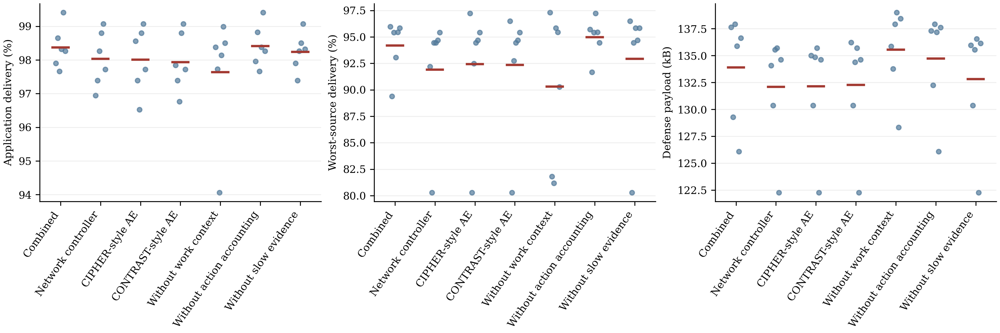

# VIGILFOIL

**Workload and Response-Aware Evidence Accounting for Budgeted Security Monitoring in RPL Networks**

Research implementation by **Sharad Kumar Dubey and Vasim Khan**, Department of Computer Science and Engineering, IIITDM Kancheepuram.

VIGILFOIL combines host-resource monitoring with network evidence accounting for constrained IoT networks. It distinguishes resource use explained by authorized work from unexplained activity, and accounts for defensive redirection before deciding whether packet delivery is suspicious. A gateway uses this evidence to prioritize authenticated queries and limited delivery repair.

This repository contains the combined implementation, frozen models, firmware, accepted Cooja recordings, comparison and ablation results, and the paper's LaTeX sources. The evaluated system uses ten instruction-emulated Z1 motes and a Python gateway. Inference runs on the gateway; it is not deployed on the motes.

## Architecture

```text
Z1 source / relay / helper motes
  | resource counters, source-work reports, application packets
  v
Z1 root: authentication, replay checks, receipts, command queue
  | received records
  v
Python gateway
  +-- Host detector: authorized-work residuals, GRU/classifier, slow evidence
  +-- Network controller: offers, original attempts, repair and lease accounting
  +-- Admission policy: query priority, helper eligibility, payload reservation
  |
  +-- authenticated query / repair commands --> root --> motes
```

The implementation includes:

- **Workload-aware host evidence.** A benign resource predictor accounts for authorized computation and network activity. Signed residuals feed a 16-unit GRU over eight observations and a histogram gradient boosting classifier.
- **Persistent evidence.** A separate decaying residual accumulator complements the neural warning lane. Warning persistence and causal per-device state support intermittent observations.
- **Response-aware accounting.** Source-work reports, deduplicated receipts and root-issued leases separate original attempts from repair and redirection. A successful repair does not certify the original path as healthy.
- **Budgeted evidence and repair.** Queries and helper repair compete for a 480-byte discretionary payload reservation per 10-second decision. Mandatory telemetry is measured separately.
- **Authenticated transport.** Session, sequence, freshness and scope checks protect reports and commands. Authentication establishes message origin, subject to the trusted-monitor assumption.

## Repository layout

```text
.
├── README.md
├── requirements.txt                 # Recorded Python package versions
├── paper-overleaf/                  # Paper: main.tex, references.bib, images/
├── *.pdf                            # Compiled paper
└── testing/
    ├── combined_system/             # Integrated gateway and evaluation
    │   ├── scripts/                 # Collection, training, execution, analysis, validation
    │   ├── firmware/{root,leaf}/     # C sources and accepted Z1 firmware images
    │   ├── models/                  # Frozen combined model
    │   ├── configs/                 # Source/final matrices, lab fixtures, Cooja template
    │   ├── scenarios/               # Accepted deployment configurations
    │   ├── logs/                    # Raw records from 4 source + 42 final runs
    │   ├── data/                    # Derived source/calibration observations
    │   ├── results/                 # Tables, figures, predictions, hashes and checks
    │   ├── METHOD.md                # Mechanism and assumptions
    │   ├── PROTOCOL.md              # Experimental design and acceptance criteria
    │   └── REPORT.md                # Detailed measured results and limitations
    ├── host_detector/               # Resource predictor, GRU and streaming evidence
    ├── network_controller/          # Frozen network-priority weights
    ├── baselines/                   # CIPHER/CONTRAST architectural implementations
    ├── simulation/                  # Headless Cooja launcher
    ├── runtime-versions.json        # Simulation/runtime versions and source commits
    ├── env.sh                      # Project-local Java and cache configuration
    ├── tools/                      # Local third-party tools, excluded from Git
    ├── venv/                       # Local Python environment, excluded from Git
    └── cache/                      # Runtime caches, excluded from Git
```

The module names describe implementation responsibilities. Original identifiers inside saved run metadata and firmware are retained for traceability. The implementation details of host detection and network decisions are connected by `combined_system/scripts/gateway.py`.

## Experiments and data

The current comparison uses **42 final runs**: seven policies, three conditions and two deployment blocks. Each Cooja run lasts 900 simulated seconds. Four additional complete benign runs supply resource fitting and calibration, using separate deployment seeds. No final deployment is used for fitting or threshold selection.

| Condition | What executes in the simulation |
| --- | --- |
| Benign | Authorized work, changing legitimate network activity and radio loss |
| Sustained misuse | Hidden 250-round CPU workloads with configured selective forwarding |
| Sparse misuse with loss | Hidden 1,000-round workloads in 4-second bursts every 60 seconds, legitimate work changes, configured selective forwarding and 0.85 nominal reception |

The deployment blocks use a bypass layout with target node 2 and a grid layout with target node 3. Application offers occur at 180–840 seconds, configured attacks at 400–700 seconds, and authorized work at 300–780 seconds. Radio transmission/interference ranges are 30/45 metres. A configured forwarding attacker can have no transit opportunities in a particular routing realization; actual malicious drops are reported, including zero.

**Data source:** the integrated evaluation uses locally generated Cooja simulation data, rather than a downloaded public intrusion dataset. Raw mote events and received gateway records are retained in `logs/`; derived fitting rows are in `data/`. The combined artifact retains a supervised host head from earlier simulated training and recalibrates resource prediction and thresholds using the four benign integration runs. This repository includes that pretrained head, its inference code and the integration fitting inputs. The earlier host-head training campaign is not included, so the repository supports integration refitting and saved-model reproduction rather than complete host-head training from scratch.

## Comparisons and ablations

All seven policies share the same instrumentation, authenticated transport and network controller interface.

| Policy identifier | Configuration |
| --- | --- |
| `full` | Complete VIGILFOIL integration |
| `network_only` | Network decisions ignore host warnings; host telemetry remains enabled |
| `cipher` | Correlation-grouped LSTM autoencoder adaptation replaces the host warning generator |
| `contrast` | CPU/TX LSTM autoencoder adaptation replaces the host warning generator |
| `no_work` | Authorized-work context is removed from resource prediction |
| `no_action` | Valid defensive redirection does not reduce original-path expectations |
| `no_memory` | Slow residual accumulator is removed; the GRU remains enabled |

CIPHER and CONTRAST are matched architectural adaptations to the available features and gateway interface. They are not complete reproductions of the original distributed frameworks. Their benign-only training differs from the supervised host head used by VIGILFOIL. See [baseline implementation scope](testing/baselines/README.md).

Measurements cover offered-work delivery, worst-source delivery, attempted defense payload, host warnings, attack onset and recovery, burst coverage, benign warnings, report coverage, and actual query/repair execution. Validation also checks raw-record and firmware hashes, authenticated command sequences and independent gateway action replay.

## Selected results

These values summarize the six final runs for each policy. They describe the compact paired study, not a deployment-wide robustness guarantee.

| Policy | Mean delivery | Mean defense payload/run | Attack episodes covered | Sparse bursts covered |
| --- | ---: | ---: | ---: | ---: |
| VIGILFOIL | 98.37% | 133,901 B | 4/4 | 7/10 |
| Network only | 98.03% | 132,095 B | Host warnings disabled | Host warnings disabled |
| CIPHER adaptation | 98.01% | 132,137 B | 0/4 | 0/10 |
| CONTRAST adaptation | 97.93% | 132,261 B | 0/4 | 0/10 |
| Without work context | 97.63% | 135,553 B | 4/4 | 10/10 |
| Without action accounting | 98.42% | 134,725 B | 4/4 | 7/10 |
| Without slow evidence | 98.24% | 132,802 B | 1/4 | 3/10 |

The full system improves mean delivery by 0.34 percentage points over the equally instrumented network-only control, with about 1.38% more payload in the mean paired comparison. It produces warnings on 322/2,074 scored observations in complete benign runs (15.53%). The separate pooled nonattack-observation false-positive rate is 11.03%. These denominators represent different evaluation slices.

Removing work context increases burst coverage but also increases benign warnings and reduces delivery. Removing action accounting slightly improves delivery while increasing payload. The experiments therefore support a measured trade-off, with persistent evidence contributing to episode coverage. They do not establish universal superiority over the controls.

Full tables: [policy summary](testing/combined_system/results/paper-summary.csv), [per-run results](testing/combined_system/results/paper-runs.csv), [paired differences](testing/combined_system/results/paired-differences.json), and [detailed report](testing/combined_system/REPORT.md).



## Reproduce the saved results

### 1. Python environment

The recorded environment uses Python 3.12.3 and CPU-only PyTorch. Package versions are in `requirements.txt`. From the repository root, a fresh environment can be prepared with:

```bash
python3 -m venv testing/venv
testing/venv/bin/python -m pip install -r requirements.txt \
  --extra-index-url https://download.pytorch.org/whl/cpu
```

On the original workstation the local environment is already present. Downloaded runtimes and environments are excluded from Git; a clone must provision them separately. Package availability and platform compatibility are not checked by the saved-result replay.

### 2. Analyze and validate

From the repository root:

```bash
cd testing/combined_system
../venv/bin/python scripts/analyze.py
../venv/bin/python scripts/write_paper_results.py
../venv/bin/python scripts/validate.py
```

These commands use the accepted recordings; they do not launch new attacks or Cooja simulations. Analysis rewrites derived tables/report files. Validation checks hashes and independently replays gateway decisions using the frozen artifact, then refreshes validation manifests. Load the repository's model artifacts only from a trusted copy, since Python pickle is used for serialization.

### 3. Run new Cooja experiments

New simulation runs additionally require the project-local Contiki-NG/Cooja, JDK and MSP430 toolchains. Their layout and build steps are described in [simulation setup](testing/simulation/README.md). The supplied accepted `.z1` images allow execution without recompiling the firmware.

Use a **separate working copy** when executing the full collection/training pipeline, since its configured names overwrite saved runs and the model:

```bash
cd testing/combined_system
../venv/bin/python scripts/run_sources.py
../venv/bin/python scripts/run_study.py
../venv/bin/python scripts/analyze.py
../venv/bin/python scripts/write_paper_results.py
../venv/bin/python scripts/validate.py
```

`run_sources.py` collects four benign fitting/calibration runs. `run_study.py` refits the resource predictor and baseline detectors, calibrates thresholds, freezes the artifact and runs the final matrix. It retains the supplied pretrained supervised host head. Configuration details are in [PROTOCOL.md](testing/combined_system/PROTOCOL.md); controller and detector details are in [METHOD.md](testing/combined_system/METHOD.md).

## Scope and limitations

- Two deployment blocks are evaluated, with seed and topology confounded. Observation counts are not independent deployment sample sizes.
- The gateway pauses simulated time during inference. Root polling and radio delays are simulated; gateway wall time is not a real-time hardware measurement.
- Host measurements assume an honest isolated monitor and benign startup. There is no hardware attestation or protection against fabricated measurements from a fully compromised monitor.
- Host warnings guide investigation and helper selection. The implementation does not terminate unauthorized host processes.
- The reservation bounds discretionary payload admission, not total traffic, physical airtime, retransmissions or energy. Mandatory telemetry is substantial and remains enabled for every comparison policy.
- FIT IoT-LAB testing and physical hardware validation have not been performed. Optional task-integrity verification is outside this combined implementation.

## Paper and attribution

The IEEE-format manuscript is in [paper-overleaf/main.tex](paper-overleaf/main.tex), with external references in [references.bib](paper-overleaf/references.bib). CIPHER is the main motivating paper; the manuscript also discusses the related systems and evaluation boundaries. Third-party runtimes retain their own licenses and are not included by the repository's Git ignore rules. No project-wide software license is asserted here.
